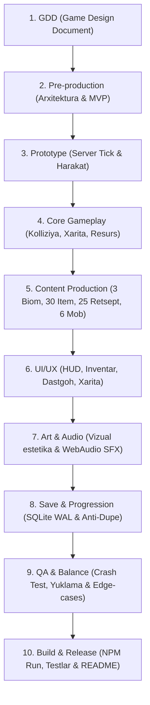

# MYTHIC REALMS: 10 TA BOSQICHLI ISHLAB CHIQISH VA TOPSHIRISH REJASI (ROADMAP)

Ushbu hujjat **Mythic Realms — 2D Multiplayer Survival & Crafting Sandbox** kapstone loyihasini noldan to'liq ishga tushirishgacha bo'lgan 10 ta ishlab chiqish bosqichining batafsil spetsifikatsiyasidir.

---

---

### 1-Bosqich: GDD (Game Design Document)
* **Asosiy maqsad:** O'yinchilar umumiy procedural dunyoda tirik qolishi, resurs yig'ishi, baza qurishi, qurollar yasashi va 2 ta afsonaviy bossni yengib, "G'alaba Monoliti"ni qurishi.
* **Core Loop:**
  $$\text{Resurs yig'ish} \longrightarrow \text{Baza qurish va Crafting} \longrightarrow \text{Omon qolish (Ochlik/Tun)} \longrightarrow \text{Ekspeditsiya va Boss Jangi} \longrightarrow \text{Olamni Qutqarish}$$
* **Boshqaruv sxemasi:**
  * Harakat: `W, A, S, D` (Yugurish: `Shift`)
  * Jang / Qazish / Qurish: Sichqoncha chap tugmasi (`LMB`)
  * Obyekt bilan aloqa (Sandiq, Dastgoh, Gulxan): `E` yoki Sichqoncha o'ng tugmasi (`RMB`)
  * Inventar: `I` yoki `Tab`
  * Dastgoh / Crafting: `C`
  * Pauza / Menyuga chiqish: `Esc`
* **G'alaba va Mag'lubiyat shartlari:**
  * *G'alaba:* 2-boss (Shadow Wyrm) dan tushgan "Heart of the Realm" artefakti orqali markaziy Monolitni qurish va faollashtirish.
  * *Mag'lubiyat / O'lim:* Salomatlik 0 ga tushganda inventardagi buyumlar o'lgan joyda qoladi; o'yinchi boshlang'ich spawn zonasida qayta tiriladi.

---

### 2-Bosqich: Pre-production
* **Vizual va janr yo'nalishi:** Terraria, Necesse va Don't Starve uslubidagi 2D Top-Down retro-pikselli, qorong'u/sirli survival muhiti.
* **MVP (Minimum Viable Product) chegarasi:**
  * 1 ta server instansiyasi (Node.js + WebSockets).
  * Kamida 2 ta parallel brauzer orqali sinxron multiplayer.
  * 3 xil biomga ega protsedurali cheksiz chunklar generatori.
  * 30 ta item, 25 ta crafting retsepti, 4 ta monster va 2 ta boss.
  * Doimiy SQLite xotirasi (Crash-resilient WAL).
* **Texnik xatarlar (Risks) va ularning yechimi:**
  * *Xatar 1: Tarmoq uzilishi tufayli item duplikatsiyasi.* $\to$ Yechim: Har bir itemga UUID berish va tranzaksiyalarni atomik navbatda bajarish.
  * *Xatar 2: Desinxronizatsiya (Desync) va ghost hits.* $\to$ Yechim: Server-authoritative hitbox hisob-kitobi va mijoz interpolatsiyasi.
  * *Xatar 3: Server to'satdan o'chganda dunyo buzilishi.* $\to$ Yechim: SQLite WAL rejimi va 10 soniyalik periodik xotira suratlari.

---

### 3-Bosqich: Prototype
* **Tarmoq yadrosi:** Node.js WebSocket serveri 30 Hz tick-loop bilan ishlaydi.
* **Mijoz bog'lanishi:** Brauzerda WebSocket ulanishi o'rnatiladi, server o'yinchiga unikal sessiya ID beradi.
* **Harakat sinovi:** WASD tugmalari bosilganda faqat vektor buyrug'i serverga ketadi; server tezlikni va chegaralarni tekshirib, yangi koordinatalarni qaytaradi.
* **Ko'rsatish (Rendering):** HTML5 Canvas orqali o'yinchi sprite'i va harakat animatsiyasi 60 FPS bilan chiziladi.

---

### 4-Bosqich: Core Gameplay
* **Kolliziyalar (Collision):** AABB (Axis-Aligned Bounding Box) va Grid-based tile kolliziyasi (suvdan, qattiq devorlardan va qoyalardan o'tib ketolmaslik).
* **Kamera boshqaruvi:** Dinamik kamera (Smooth Camera Lerp) o'yinchi harakatiga ergashadi va dunyo chegarasini hisobga oladi.
* **Resurs qazish mexanikasi:**
  * Daraxtga zarba berish $\to$ chidamliligi kamayadi $\to$ yog'och va urug' tushadi.
  * Qoyaga cho'kich urish $\to$ tosh, ko'mir yoki temir rudasi tushadi.
* **Kun / Tun sikli:** 12 daqiqalik yorug'lik aylanishi (kunduzi yorug', kechasi mash'alasiz zulmat).

---

### 5-Bosqich: Content Production
* **3 ta Biom:** Yashil O'rmon (Forest), Quruq Cho'l (Desert), Muzlik/G'orlar (Ice Caverns).
* **30 ta Resurs va Buyum:** Daraxt, tosh, temir, oltin, obsidian, qurollar, asboblar, kiyimlar, dori-darmonlar va relikviyalar.
* **25 ta Crafting Retsepti:** Cho'ntakda yasaladigan oddiy asboblar va Dastgohda (Workbench) yasaladigan murakkab jihozlar.
* **Dushmanlar va Bosslar:**
  * Slime, Zombie, Skeleton Archer, Scorpion (har biri o'z AI xatti-harakatiga ega).
  * 1-Boss: Ancient Treant (AoE hujum, ildiz qopqoni).
  * 2-Boss: Shadow Wyrm (Zulmat ajdari, ko'p fazali jang).

---

### 6-Bosqich: UI/UX
* **Asosiy menyu va Lobby:** Server holatini ko'rish, o'yinchi nomini kiritish, xarakter yaratish.
* **Gameplay HUD:** Salomatlik (HP bar), Ochlik (Hunger bar), Chidamlilik (Stamina bar), Kun/Tun soati, Mini-xarita va Quickslot (1–8 raqamlar).
* **Interaktiv Oynalar:**
  * 30 katakli Inventar (`I`).
  * 25 retseptli Crafting menyusi (`C`).
  * Sandiq ombori interfeysi (`E`).
  * Respawn (qayta tirilish) va Victory (G'alaba nishonlash) ekranlari.

---

### 7-Bosqich: Art & Audio
* **Vizual estetika:** HTML5 Canvas orqali protsedurali yuqori sifatli pikselli spritelar, yorug'lik effektlari (Radial lighting gradient for torches/day-night), zarrachalar (Particles - yog'och qirindilari, qon, sehr chaqnashlari).
* **Audio dvigateli:** Web Audio API asosidagi retro 8-bit/16-bit sintezator. Tashqi og'ir audio-fayllarsiz brauzerda toza ovozlar yaratiladi:
  * Qadam tovushlari, daraxt chopish, tosh qazish, qilich zarbasi, dushman o'limi, yirtqich g'ulomi va kechki ambient musiqasi.

---

### 8-Bosqich: Save & Progression
* **Doimiy saqlash (SQLite WAL):**
  * O'yinchining pozitsiyasi, salomatligi, ochligi, inventar slotlari.
  * Xaritadagi barcha o'zgarishlar (buzilgan bloklar, qo'yilgan devorlar, sandiqlar).
* **Anti-Dupe Kafolati:** Sandiqqa solish va yerdan olishda atomik tranzaksiya (`BEGIN IMMEDIATE TRANSACTION`).
* **Avto-saqlash:** Har 10 soniyada butun dunyo holati bazaga sinxronlanadi. Server majburiy to'xtatilganda (SIGINT/crash) darhol to'liq tiklanish kafolatlanadi.

---

### 9-Bosqich: QA & Balance
* **Stress va Anti-Dupe sinovlari:** Bir vaqtning o'zida ikkita o'yinchi bir xil buyumni sandiqdan olishga uringan holatni (race condition) avtomatlashtirilgan test bilan tekshirish.
* **Crash Recovery testi:** Server ishlab turgan vaqtda jarayonni to'xtatish (`kill -9`) va qayta yoqilganda barcha progress joyida ekanligini verifikatsiya qilish.
* **Balans sozlamalari:** Asboblar chidamliligi, qurollar kuchi, ochlik sarflanish tezligi va dushmanlar joni o'yinchiga qiziqarli qiyinchilik tug'diradigan darajada sozlanadi.

---

### 10-Bosqich: Build & Release
* **Yagona buyruq bilan ishga tushirish:** `npm start` (barcha server, mijoz va statik fayllarni bitta portda ko'taradi).
* **Avtomatlashtirilgan testlar:** `npm test` orqali tarmoq, ma'lumotlar bazasi va inventar yaxlitligi sinovdan o'tadi.
* **Hujjatlashtirish:** `README.md`, arxitektura chizmalari va loyihani himoya qilish uchun to'liq yo'riqnoma.
