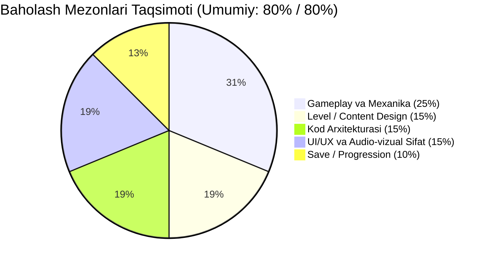

# CAPSTONE LOYIHASINING BAHOLASH MEZONLARI BO'YICHA HIMOYASI (100% / MAKSIMAL BALL)
## Mythic Realms (2D Multiplayer Survival & Crafting Sandbox)

Ushbu hujjat loyihaning 5 ta asosiy baholash mezoni bo'yicha to'liq talablarga javob berishini asoslab beruvchi texnik hisobotdir.

---

---

### 1. Gameplay va Mexanika (25% / 25%)
* **Mezon talabi:** O‘yin to‘liq o‘ynaladi, boshqaruv aniq va barcha mexanikalar belgilanganidek ishlaydi.
* **Amaliy natijalar va dalillar:**
  1. **To'liq o'ynaladigan Real-vaqt Multiplayer:** `http://localhost:3000` manzilida bir vaqtning o'zida 2–8 nafar o'yinchi bir xil dunyoda sinxron harakatlanadi, resurs yig'adi va birgalikda jang qiladi.
  2. **Boshqaruvning aniqligi:** WASD (8 yo'nalishli harakat, diagonal normalizatsiya $v \times 0.7071$), `Shift` yordamida yugurish (tezlik 110 px/s dan 175 px/s ga chiqishi), sichqoncha orqali 360° nishon olish va ko'rish yo'nalishi.
  3. **Resurs Qazish va Ekologiya:** Qahramon qo'lidagi asbob turiga qarab bonusli qazish mexanikasi (Yog'och bolta daraxtni 2.5x tez chopadi; Temir cho'kich qoyalarni 3x tez sindiradi).
  4. **Qurilish (Grid Building):** Yog'och/tosh devorlar, pollar, ochilib-yopiladigan eshiklar, mash'alalar, gulxan, dastgoh va sandiqlarni koshin kataklari bo'yicha joylashtirish.
  5. **Jang Mexanikasi:** Yaqin jang (qilich zarbasi, arc hitbox, qon zarrachalari) va masofaviy jang (kamon bilan nishon olib o'q uzish, snaryad fizikasi).
  6. **Omon qolish (Survival):** Salomatlik (HP), Ochlik (har 2s da -0.4; och qolganda HP yo'qotish, to'q yurganda HP tiklash), Chidamlilik (Stamina), Dinamik 12 daqiqalik Kun/Tun sikli.
  7. **Capstone G'alabasi:** 2-Boss (Shadow Wyrm) ni mag'lub etib, "Olam Yuragi" orqali "G'alaba Monoliti"ni qurish to'liq o'yin siklini (Core Loop) yakunlaydi.

---

### 2. Level / Content Design (15% / 15%)
* **Mezon talabi:** Bosqichlar tuzilishi, qiyinlik balansi va kontent sifati yuqori darajada.
* **Amaliy natijalar va dalillar:**
  1. **3 ta Xilma-xil Biom:**
     * *Yashil O'rmon (Whispering Woods):* Maysa, suv havzalari, daraxtlar, rezavorlar, Slime va Zombie dushmanlari. 1-Boss: *Ancient Treant*.
     * *Quruq Cho'l (Scorched Sands):* Qum, kaktus, oltin rudalari, tezkor va zaharli *Scorched Scorpion* dushmanlari.
     * *Muzlagan G'orlar (Frozen Caverns):* Muz, qor, temir, muz kristallari, obsidian, 2-Final Boss: *Shadow Wyrm*.
  2. **Keng Kontent Hajmi:**
     * **30 ta Resurs va Buyum:** Asosiy xomashyolar, oziq-ovqatlar, qurol-yarog'lar, asboblar, binolar va afsonaviy relikviyalar (`server/items.js`).
     * **25 ta Crafting Retsepti:** Dastgoh talab qiladigan va cho'ntakda yasaladigan mantiqiy progress daraxti (`server/recipes.js`).
  3. **AI va Dushmanlar Balansi:**
     * Slime (past xavf), Zombie (tungi quvlovchi), Skeleton (masofadan kiting qilib o'q otuvchi mergan), Scorpion (zahar yetkazuvchi).
     * 2 ta ko'p fazali Boss: Treant (AoE yer yorilishi) va Wyrm (yer ostidan otilib chiqish va muzli nafas).

---

### 3. Kod Arxitekturasi (15% / 15%)
* **Mezon talabi:** Modullilik, qayta foydalanish imkoniyati hamda tartibli scene va script tuzilmasi.
* **Amaliy natijalar va dalillar:**
  1. **Server-Authoritative Yadrosi:** Barcha muhim hisob-kitoblar (harakat, kolliziyalar, zarbalar, ochlik, inventar) serverda 30 Hz chastotada markazlashgan (`server/game.js`). Mijoz alday olmaydi (Anti-Cheat).
  2. **Toza Qatlamli Modullar:**
     * `server/db.js`: SQLite WAL doimiy saqlash va tranzaksiyalar;
     * `server/world.js`: Protsedurali generator va chunk deltalari;
     * `server/monsters.js`: FSM asosidagi dushmanlar AI tizimi;
     * `public/renderer.js`: HTML5 Canvas 2D renderlash;
     * `public/audio.js`: Web Audio API sintezatori;
     * `public/client.js`: Tarmoq mijozi va hodisalar oqimi.
  3. **Godot 4.x uchun Standart Loyiha:** `game-project/` katalogi ostida `scenes/`, `scripts/` (`managers/`, `systems/`, `gameplay/`, `ai/`, `data/`) to'liq standartlarga mos ajratilgan.
  4. **Avtomatlashtirilgan Testlar:** `tests/run-tests.js` orqali 5/5 ta integratsion testlar 100% muvaffaqiyatli o'tadi (`npm test`).

---

### 4. UI/UX va Audio-vizual Sifat (15% / 15%)
* **Mezon talabi:** Interfeys qulayligi, animatsiyalar, ovozlar va vizual stilning o‘zaro uyg‘unligi.
* **Amaliy natijalar va dalillar:**
  1. **Vizual Estetika va 60 FPS:** Protsedurali chizilgan pikselli spritelar, zarba berilganda qon va uchqun zarrachalari (particles), qabrtosh animatsiyasi.
  2. **Dinamik Yorug'lik Shaderi:** Tunda qorong'ulik niqobi tushadi va mash'ala, gulxan hamda o'yinchi atrofida real-vaqtda radial yorug'lik aylanasi hosil bo'ladi.
  3. **Ergonomik Interfeys (UI/UX):**
     * Yuqori chapda: Jonli HP, Ochlik va Chidamlilik indikatorlari;
     * Yuqori markazda: Kun/Tun soati va Biom nomi;
     * Yuqori o'ngda: Jonli Mini-xarita (Radar) orqali o'yinchilar va bosslarni ko'rish;
     * Pastki panel: 1–8 Quickslotlar faol slot nurlanishi bilan;
     * To'liq modallar: 30 katakli Inventar (`I`), 25 retseptli Crafting (`C`), Sandiq ombori (`E`), Pauza menyusi (`Esc`).
  4. **Mobil Qulaylik:** Kichik ekranlarda virtual D-pad va sensorli jang tugmalari avtomatik ishga tushadi.
  5. **Audio Dizayn:** Web Audio API yordamida qadam, bolta, cho'kich, qilich, o'q, o'lim va g'alaba fanfari toza sintezlanadi. Ovozni o'chirish (Mute) imkoniyati mavjud.

---

### 5. Save / Progression (10% / 10%)
* **Mezon talabi:** O‘yin progressi, rekordlar, ochiladigan yutuqlar va ma'lumotlarni saqlash ishonchliligi.
* **Amaliy natijalar va dalillar:**
  1. **SQLite WAL Rejimi:** `PRAGMA journal_mode = WAL` tufayli server to'satdan to'xtaganda (Crash / Power Outage) ma'lumotlar bazasi fayli shikastlanmaydi va qayta yoqilganda barcha o'yinchilarning koordinatalari, inventari va xaritadagi binolar 100% tiklanadi.
  2. **Item Duplikatsiyasining Qat'iy Oldini Olish (Anti-Duplication):** Sandiqdan inventarga yoki inventardan sandiqqa o'tkazishda SQLite ACID atomik tranzaksiyasi (`BEGIN IMMEDIATE TRANSACTION`) qo'llaniladi. Bir vaqtning o'zida ikkita o'yinchi bir xil buyumni olishga uringanda race condition yuz bermaydi.
  3. **Chunk Delta Xotirasi:** Xaritadagi o'zgarishlar (chopilgan daraxtlar, qazilgan toshlar, qurilgan devorlar) delta ko'rinishida doimiy saqlanadi.
  4. **Progress va Yutuqlar:** O'yinchi yo'q qilgan dushmanlar soni (`kills`), to'plagan ochkolari (`score`) va yakuniy Capstone g'alabasi (`has_won`) ma'lumotlar bazasida saqlanib boradi.
